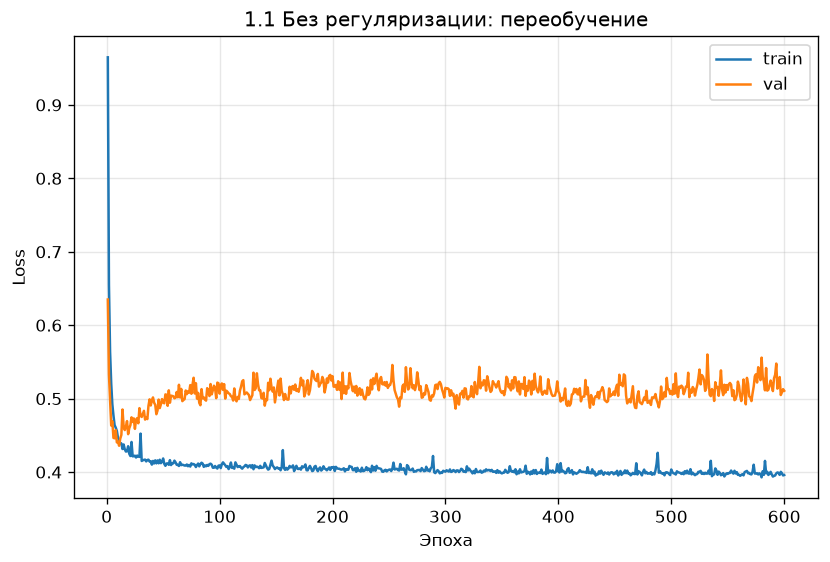
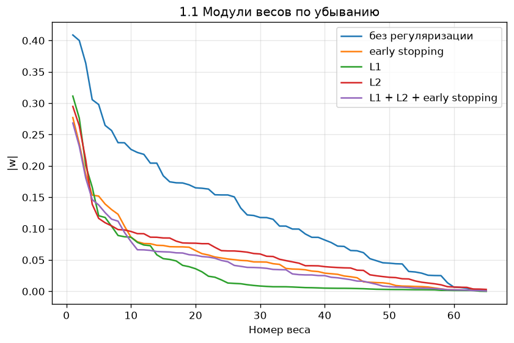
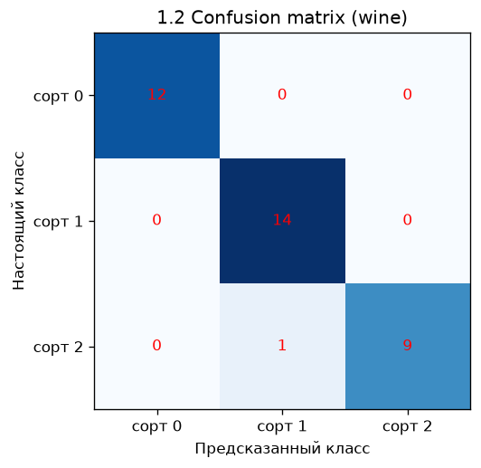
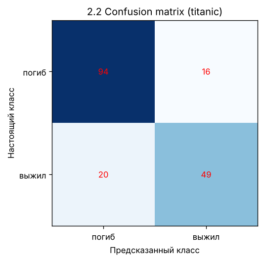
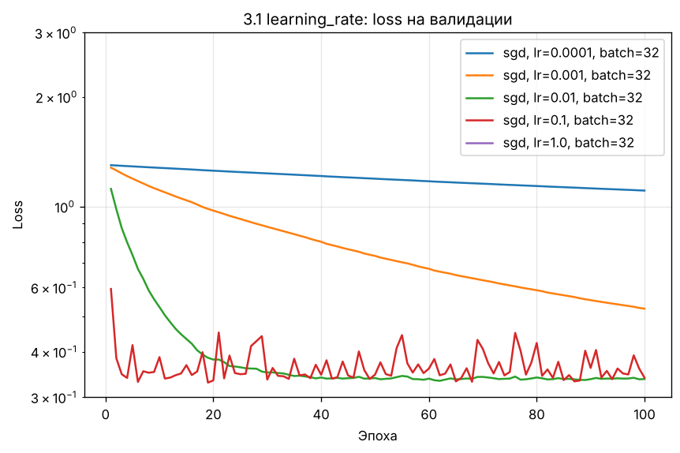
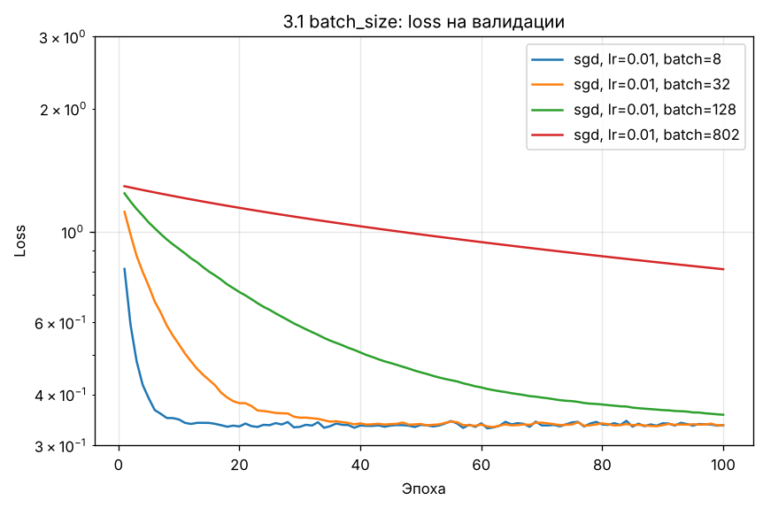
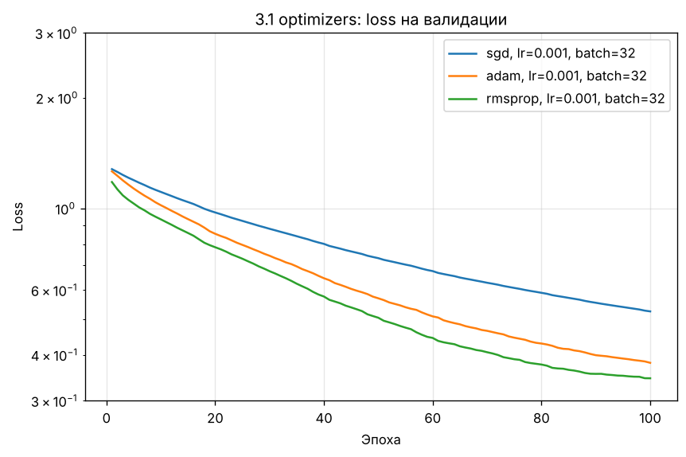
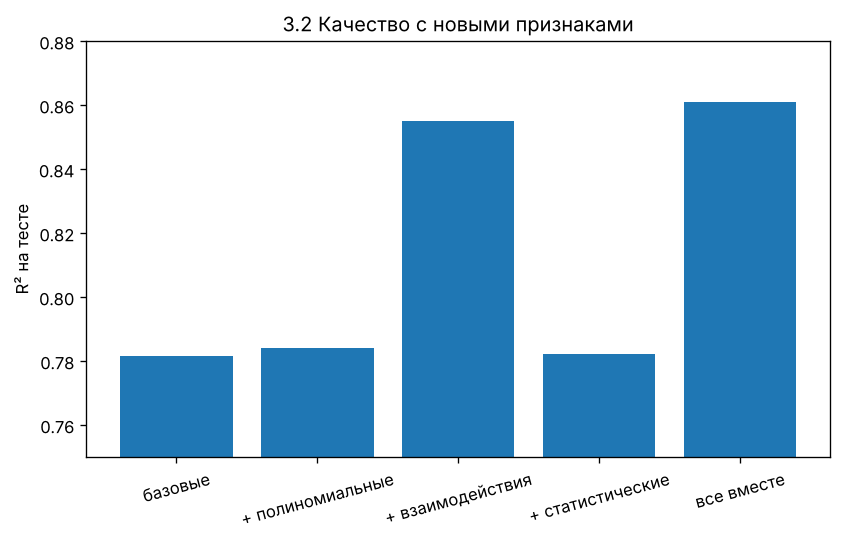

# Домашнее задание к уроку 2: линейная и логистическая регрессия

## Структура

```
homework/
├── homework_model_modification.py  # 1. L1/L2, early stopping, многоклассовая логрегрессия, метрики
├── homework_datasets.py            # 2. CSVDataset с предобработкой, обучение на CSV
├── homework_experiments.py         # 3. Гиперпараметры и feature engineering
├── test_homework.py                # unit-тесты критических функций (8 тестов)
├── data/                           # insurance.csv, titanic.csv
├── models/                         # сохранённые веса (state_dict, *.pt)
├── plots/                          # графики и таблицы результатов (*.png, *.csv)
└── README.md
```

Код модульный: файлы 2 и 3 импортируют модели, цикл обучения и метрики из файла 1,
а файл 3 — ещё и `CSVDataset` из файла 2.

## Запуск

```bash
pip install torch scikit-learn matplotlib numpy pandas
cd homework
python homework_model_modification.py   # ~10 c
python homework_datasets.py             # ~5 c
python homework_experiments.py          # ~30 c
python test_homework.py                 # unit-тесты
```

Ход обучения пишется в консоль через `logging`, графики сохраняются в `plots/`, веса — в `models/`.
Числа ниже получены на CPU, PyTorch 2.14; на другой версии они могут немного отличаться.

## Датасеты

| Файл | Задача | Строк | Ответ | Источник |
| --- | --- | --- | --- | --- |
| `data/insurance.csv` | регрессия | 1338 | `charges` — сумма медстраховки, $ | [stedy/Machine-Learning-with-R-datasets](https://github.com/stedy/Machine-Learning-with-R-datasets/blob/master/insurance.csv) |
| `data/titanic.csv` | бинарная классификация | 891 | `Survived` — выжил ли пассажир | [datasciencedojo/datasets](https://github.com/datasciencedojo/datasets/blob/master/titanic.csv) |

В 1.1 и 1.2 используются встроенные датасеты sklearn: diabetes (как в `utils.py` урока) и wine (3 класса).
Данные везде делятся на train / val / test = 60 / 20 / 20 %: val нужен для early stopping и
сравнения настроек, test — для финальной оценки.

## Задание 1. Модификация моделей

### 1.1 Линейная регрессия: L1, L2, early stopping

- `regularization_penalty` — штраф `l1·Σ|w| + l2·Σw²` (bias не штрафуется), прибавляется к MSE в `train_model`.
- `EarlyStopping` — останавливает обучение, если val loss не улучшался `patience` эпох,
  и возвращает веса лучшей эпохи.
- Чтобы было что регуляризовать, 10 признаков diabetes расширены квадратами и попарными
  произведениями до 65 (`expand_polynomial`) — при 264 обучающих примерах модель переобучается.

| Модель | Эпох | Test R² | Test RMSE | Весов с \|w\| < 0.01 |
| --- | --- | --- | --- | --- |
| без регуляризации | 600 | 0.380 | 57.3 | 6 из 65 |
| early stopping | 41 (лучшая 11) | 0.479 | 52.5 | 15 из 65 |
| L1, λ=0.02 | 600 | 0.484 | 52.3 | 37 из 65 |
| L2, λ=0.05 | 600 | 0.456 | 53.7 | 7 из 65 |
| L1 + L2 + early stopping | 41 (лучшая 11) | 0.484 | 52.3 | 17 из 65 |

Без защиты модель переобучилась: train loss падает, val loss растёт. И регуляризация, и early stopping
это исправляют. L1 к тому же отключила больше половины признаков.




### 1.2 Логистическая регрессия на несколько классов

- `LogisticRegressionModel(in_features, num_classes)` — `num_classes` выходов, softmax +
  `CrossEntropyLoss`. При `num_classes=2` работает как обычная бинарная.
- Метрики написаны вручную и проверены против sklearn в тестах: `confusion_matrix`,
  `precision_recall_f1` (macro для 3+ классов), `roc_auc` (one-vs-rest для 3+ классов).
- `plot_confusion_matrix` рисует матрицу ошибок.

Wine, test (36 вин): accuracy **0.972**, precision **0.978**, recall **0.967**, F1 **0.971**, ROC-AUC **1.000**.



## Задание 2. Работа с датасетами

### 2.1 CSVDataset

- `detect_column_types` сама определяет тип столбца: numeric, binary, categorical, а текст почти
  без повторов (имена, номера билетов) пропускает.
- `TabularPreprocessor`: пропуски заполняются медианой или модой, числа стандартизуются,
  бинарные столбцы превращаются в 0/1, категории — в one-hot. Все статистики считаются
  только по train (`fit`) и применяются к val/test (`transform`), чтобы не было утечки данных.
- `CSVDataset(torch.utils.data.Dataset)` реализует `__len__` и `__getitem__`. Через параметр
  `reference` val/test берут предобработку у train. Ответ регрессии стандартизуется,
  `inverse_target` возвращает исходные единицы.

### 2.2 Обучение на CSV

| Датасет | Модель | Результат на test |
| --- | --- | --- |
| insurance.csv | линейная регрессия + L2 + early stopping | R² = 0.781, RMSE = 5828 $, MAE = 4283 $ |
| titanic.csv | логистическая регрессия + early stopping | accuracy 0.799, precision 0.754, recall 0.710, F1 0.731, ROC-AUC 0.835 |

Самые важные признаки: для страховки — курение (+1.99 std ≈ +23 000 $), для Титаника — пол
(мужчины выживали реже) и класс билета.



## Задание 3. Эксперименты

### 3.1 Гиперпараметры (insurance, 100 эпох, val MSE на стандартизованном ответе)

| Что меняли | Результат |
| --- | --- |
| learning rate (SGD) | 0.0001 и 0.001 — не успели обучиться (1.106 и 0.525); 0.01 — плавно (0.337); 0.1 — быстрее всех, но шумно (0.339); 1.0 — разошлось (nan) |
| batch size (SGD, lr=0.01) | 8 и 32 — обучились (0.336, 0.337); 128 — почти (0.357); весь train (802) — всего 100 шагов, не обучился (0.809) |
| оптимизатор | при lr=0.001: SGD 0.525, Adam 0.380, RMSprop 0.345 — адаптивные быстрее; при lr=0.01 все ≈ 0.34; при lr=0.1 RMSprop сильно скачет |

Полная таблица: `plots/3_1_results.csv`.





### 3.2 Feature engineering (insurance)

| Признаки | Число признаков | Test R² | Прирост | Test MAE, $ |
| --- | --- | --- | --- | --- |
| базовые | 9 | 0.782 | — | 4270 |
| + полиномиальные (age², bmi², children²) | 12 | 0.784 | +0.003 | 4176 |
| + взаимодействия (age·bmi, bmi·smoker, age·smoker) | 12 | 0.855 | +0.074 | 2954 |
| + статистические (среднее и дисперсия ИМТ в регионе) | 12 | 0.782 | +0.001 | 4197 |
| все вместе | 18 | 0.861 | +0.079 | 2856 |

Главный выигрыш дали взаимодействия: у курильщиков сумма сильно растёт с ИМТ, а у некурящих
почти не зависит от него. Без признака bmi·smoker линейная модель не может это учесть.
Полиномиальные и статистические признаки почти ничего не добавили.



## Тесты

`python test_homework.py` — 8 тестов: штраф регуляризации, early stopping, обучение на y = 2x + 1,
метрики против sklearn (2 и 3 класса), предобработка CSV (пропуски, one-hot, статистики только
по train), функции feature engineering.
